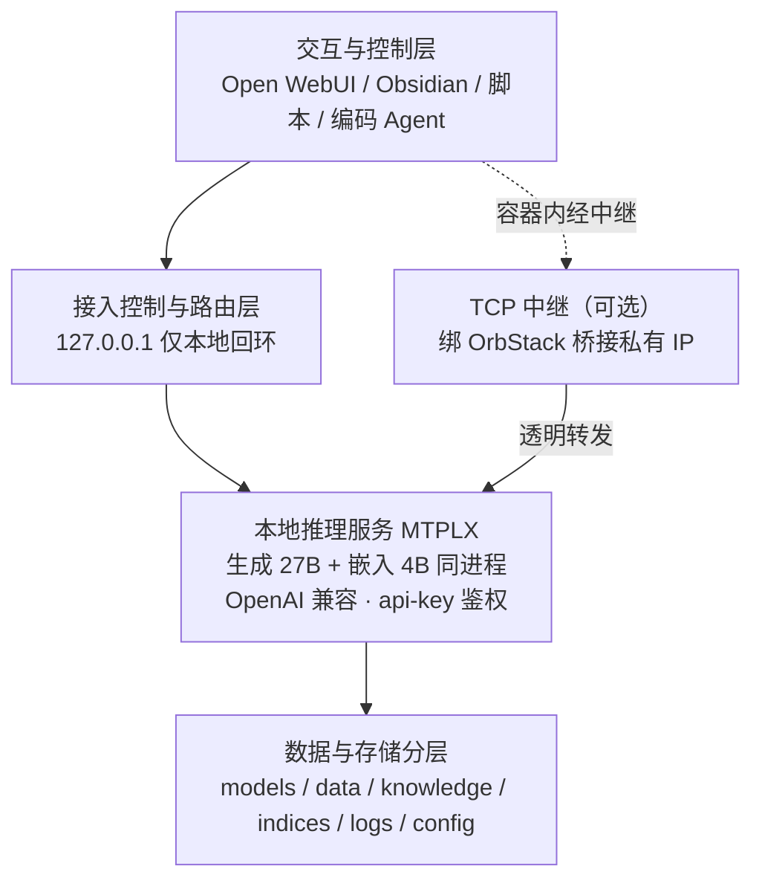
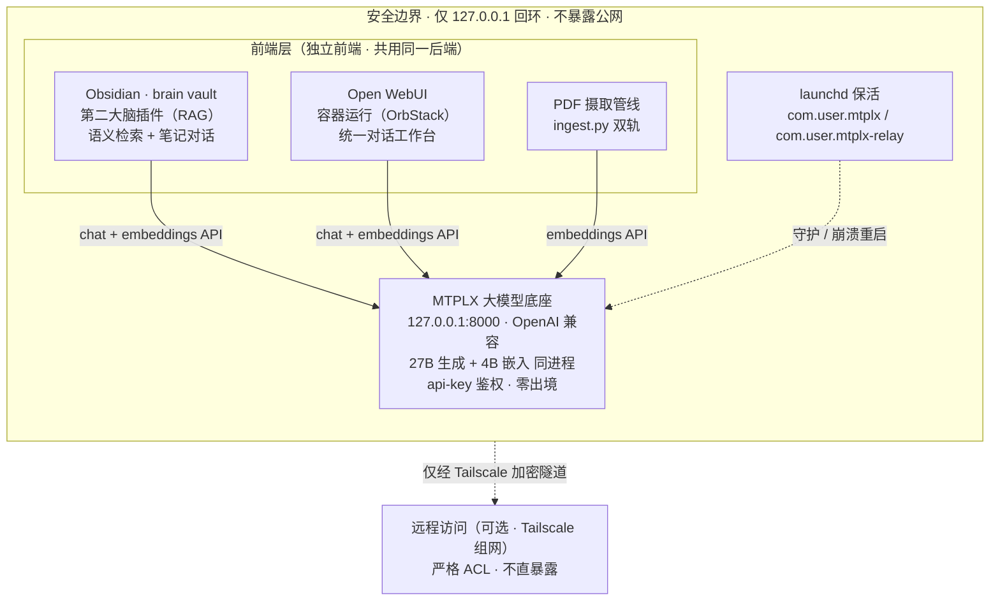

# 架构

> 设计依据：`个人AI实验室建设与部署方案.md`、`AI实验室部署设计与安全审计.md`。
> 遵循「先架构图 → 再安全审计 → 后编码」工作流；本文件是第一步产物。

## 一、系统全景拓扑



**核心设计原则**

1. **单一入口与严格回环（Loopback Only）**：所有本地推理默认仅绑定 `127.0.0.1`，绝不直接对外网开放。
2. **读写分离与数据不可变**：模型权重为只读资产；个人知识库为受控文本；派生的向量索引与推理缓存可随时全量清理重建。
3. **混合协同路由（Hybrid Routing）**：本地模型做高频执行，云端大模型仅做复杂思考；敏感数据坚守不出境。

## 二、目标架构（组件 / 数据流）



**职责说明**

- **实线**＝数据流（前端 → MTPLX 本地推理 → 返回；笔记内容在本地完成嵌入与检索，**不出本机**）。
- **虚线**＝安全运维贯穿（持久化保活、远程访问须经加密隧道）。
- **一个能力一个主负责人**：模型推理只有一个入口 `MTPLX`；Obsidian 负责"知识/RAG"，Open WebUI 负责"对话工作台"，PDF 管线负责"摄取"，互不重叠，无需额外 LiteLLM 路由层。
- **关键认知**：`MTPLX` 单实例可在同一端口同时托管生成与嵌入（同一进程 `/v1/chat/completions` + `/v1/embeddings`），省一个常驻服务、契合 64GB 内存预算。

## 三、模型选型与部署路线

结合 64GB 统一内存特性（CPU/GPU/系统/开发工具共享），遵循「小步快跑、按需升阶」：

| 梯队 | 规格 | 候选架构 | 建议量化 | 预估内存 | 适用场景 |
| --- | --- | --- | --- | --- | --- |
| P0 | 7B~8B | Qwen2.5-7B 等 | Q4_K_M / Q8_0 | 5~9GB | 冒烟测试、管道贯通 |
| P1 | 14B~27B | Qwen-27B 量化版 | Q4_K_M | 18GB | **本栈主力**：深度报告、复杂代码 |
| P2 | 云端协同 | 官方云端 API | 托管式 | 0 | 宏观推演、长上下文排查 |

## 四、数据存放与目录分层

统一隔离根目录 `~/AI-Lab/`：

```text
~/AI-Lab/
├── 01_models/      # 权重大文件（只读、不可入 Git）
├── 02_data/        # 原始 PDF / 处理后 Markdown（文本可入 vault）
├── 03_knowledge/   # Obsidian vault（Git 追踪文本变更）
├── 04_storage_indices/  # 向量索引（易失、可重建）
├── 05_logs/        # 推理访问日志（脱敏）
└── 06_config/      # 配置模板（绝不记录明文 Token）
```

数据安全分级：公开（L1）/ 内部工作（L2）/ 高敏机密（L3，绝对禁止外部接口调用，本地日志强制脱敏）。
