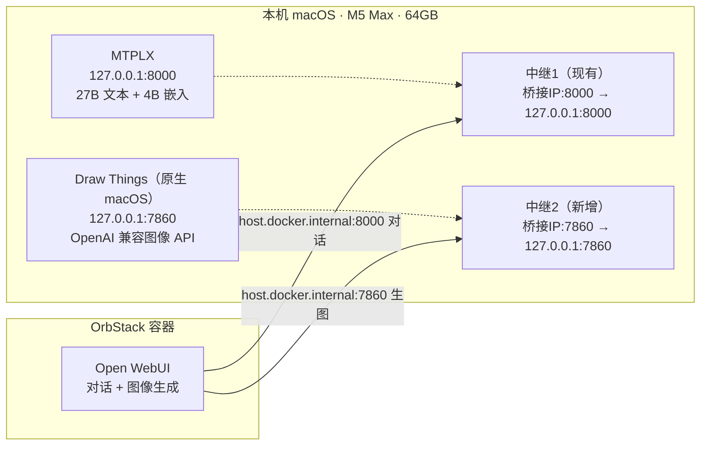

# 图像 / 视频生成接入

> 目标：在**不破坏现有安全架构**（MTPLX 仅回环 + 中继）的前提下，给 Open WebUI 加上本地生图能力，并对生视频给出硬件可行性判断。
> 硬件基线：**Mac Studio M5 Max，64 GB 统一内存**。27B 模型常驻峰值约 **32.7 GB**，剩余约 30 GB。

## 一、可行性结论（先看这个）

| 项目 | 数值 | 含义 |
| --- | --- | --- |
| 芯片 | Apple M5 Max | Metal GPU 可用（仅原生 macOS 程序能用，Linux 容器用不了） |
| 统一内存 | 64 GB | 27B 常驻 ~33 GB，**剩余约 30 GB** |
| 27B 模型 | `Qwen3.8-27B-MTPLX-Optimized-Quality` | 纯文本大模型，常驻 ~33 GB |

- **生图：建议上。** 64 GB 对"27B + 量化 FLUX/SDXL"充裕；Draw Things 原生 macOS + Metal，几乎零配置，复用中继后**不新增任何公网暴露**。
- **生视频：能做，但不建议当日常生产用。** Wan2.2 的 **5B** 变体在 64 GB 能跑，但单条 ~2 秒片段要 ~15 分钟，且必须和 27B **错峰**；14B 变体需 128 GB，**本机不可行**。高频视频需升 128 GB。

## 二、最小技术方案：27B 对话 + 图像生成

1. **生图后端跑原生 macOS**（Draw Things），**不要**放进 OrbStack 的 Linux 容器——容器拿不到 Mac 的 Metal GPU，只能走 CPU。
2. **Draw Things 只听 `127.0.0.1:7860`**（回环），通过**新增一条中继**（复用 `mtplx-relay.py` 的同款 TCP 转发）暴露给容器，安全姿态与 MTPLX 一致。
3. Open WebUI 经 `host.docker.internal:7860` 调生图 API，与现有 `:8000` 对话通道并列。

### 部署步骤
1. 安装 Draw Things（App Store 或 drawthings.ai/downloads，原生 macOS，免费本地生成）。
2. 开启 API 服务：设置 → 启用 "OpenAI Compatible API Server"，绑定 `127.0.0.1:7860`，设一个本地 API Key（可选）。
3. 下载起步模型：`FLUX.1 [schnell]`（GGUF Q8，约 16 GB）。
4. 加中继2：复制 `mtplx-relay.py` 思路（纯标准库 TCP 转发），端口改 7860，绑定 OrbStack 桥接 IP（同 `bridge100` 真实 IP），转发到 `127.0.0.1:7860`；同样接入 launchd 常驻。
5. Open WebUI 配置：管理员设置 → **Images** → 图像生成引擎选 **OpenAI**；API Base URL 填 `http://host.docker.internal:7860/v1`；模型名填 Draw Things 内标识（如 `flux.1-schnell`）；API Key 填第 2 步设的本地 Key。
6. 验收：OWUI 对话框点"图像生成"出图；`curl http://127.0.0.1:7860/v1/models` 返回 200。

### 内存共存测算
27B 常驻 ~33 GB + FLUX.1 schnell Q8 ~16 GB（生图瞬时）≈ **49 GB 峰值**，64 GB 下留 ~15 GB 余量，**可并发**。若上 FLUX.1 [dev] / Qwen-Image（~24 GB），与 27B 并发会吃紧，建议生图时临时错峰。

## 三、生图模型选型（64 GB 基线）

| 模型 | 运行时占用 | 许可证 | 适合场景 |
| --- | --- | --- | --- |
| **FLUX.1 [schnell] (Q8)** | ~16 GB | Apache 2.0（可商用） | **起步首选**：4 步出图、快、质量好 |
| **SDXL (Q8/fp16)** | ~6–8 GB | OpenRAIL-M | 最省内存；LoRA / ControlNet 生态最丰富 |
| **Qwen-Image (量化)** | ~20–24 GB | Apache 2.0 | 文字/排版/信息图/海报最强 |
| FLUX.1 [dev] | ~24 GB | **非商用** | 最高保真，但不能商用 |

> 推荐路径：先用 **FLUX.1 [schnell] Q8** 跑通，需要文字渲染再叠 **Qwen-Image**，需要风格化/LoRA 再上 SDXL。

## 四、生视频：可行性判断（独立工作流）

Open WebUI 对视频生成支持不成熟，**不建议**把视频塞进对话流，而是用**独立工具**生成后带入。两条本地路线：

| 变体 | 磁盘 | 运行时内存峰值 | 许可 | 64 GB 可行性 |
| --- | --- | --- | --- | --- |
| **Wan2.2-TI2V-5B (q8)** | ~18 GB | ~18–23 GB | Apache 2.0 | ✅ 可行，但需与 27B **错峰**；~15 min / 2 秒片段 |
| Wan2.2-TI2V-5B (bf16) | ~23 GB | ~56 GB 峰值 | Apache 2.0 | ⚠️ 与 27B 同开必爆，必须单独跑 |
| **Wan2.2-A14B** | ~64 GB | 需 128 GB | Apache 2.0 | ❌ 本机不可行 |

- **路线 A**：Draw Things 视频模式（最省事，内置 Wan 2.2 / LTX-2，原生 Metal）。
- **路线 B**：`mlx-video`（Blaizzy）把 Wan2.2 转 MLX，命令行可脚本化；推荐 **Wan2.2-TI2V-5B**。

**操作建议（视频）**：跑视频前先暂停 MTPLX（或确保 27B 不在生成中），给 Wan 让出内存；用 TI2V-5B q8 + 低帧数（41 帧 ≈ 1.7 秒）/ 低分辨率起步。文字渲染仍是本地视频模型的短板。

## 五、一句话总结

- **生图：上，推荐 FLUX.1 [schnell] Q8 + Draw Things，复用中继，零新增暴露。**
- **生视频：本机只能玩 Wan2.2 5B，慢且要错峰，不适合日常生产；真要高频视频，硬件得升 128 GB。**
