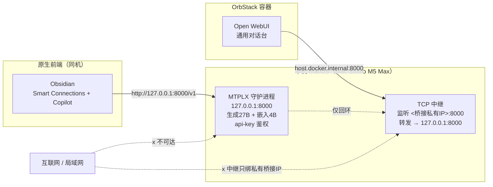

# Open WebUI 接入（容器访问仅回环 MTPLX）

> 目标：让 OrbStack 容器内的 Open WebUI 访问仅回环 `127.0.0.1:8000` 的 MTPLX，同时 **MTPLX 保持 127.0.0.1 不变、不暴露公网、不改用 pip 原生**。

## 一、为什么需要中继（方案选择）

MTPLX 仅绑 `127.0.0.1`；容器内 `host.docker.internal` 解析到**宿主机 IP**，回环绑定的服务**拒绝非回环来源**。

| 方案 | 做法 | 暴露面 | 点评 |
| --- | --- | --- | --- |
| A（备选） | MTPLX `--host 0.0.0.0` + pf 限制 8000 仅 lo0/桥接 | 全部接口（靠 pf 兜底） | 监听面变宽，依赖 pf 不出错 |
| B（否决） | pip 原生跑 Open WebUI 在宿主机 | 无 | 依赖重、构建慢 |
| **E（推荐）** | 主机侧 TCP 中继（纯 Python 标准库），绑 OrbStack 桥接私有 IP，转发到 `127.0.0.1:8000` | **仅私有桥接 IP** | **MTPLX 零改动、零防火墙、零新增包，暴露面最小** |

→ 推荐**方案 E（中继）**：MTPLX 安全姿态完全不动，唯一新增监听是绑在 OrbStack 私有桥接 IP 上的中继；MTPLX 末端仍强制 api-key，中继不存密钥、只是透明搬运 TCP。中继实现见 `scripts/mtplx-relay.py`（stdlib `socket`，无需 socat / brew）。

## 二、架构（数据流）



## 三、关键修正（实测坑）

1. **桥接 IP 机制**：容器内 `host.docker.internal` 解析到 **虚拟路由 IP `0.250.250.254`**（OrbStack 魔术地址，宿主接口上不存在，**不可绑**）。
2. **中继真正要绑**的是宿主 **`bridge100` 接口的真实 IP**（本次实测 `192.168.139.3`）：
   ```bash
   ifconfig bridge100 | awk '/inet /{print $2}'   # 例如 192.168.139.3
   ```
3. `bridge100` 的 IP 由 OrbStack 分配，重装/换网可能变化；若中继起不来先查 `ifconfig bridge100` 是否变了，变了就重填。
4. `mtplx-relay.py` 优先读环境变量 `MTPLX_RELAY_BIND_IP`，缺省自动探测（orbctl / `/etc/hosts`）兜底；探测失败回退 `0.0.0.0` 并明确告警（此时需配合方案 A 的 pf 收紧）。

## 四、精确命令（方案 E）

### 4.1 安装 OrbStack（需 GUI 完成）
- 方式 A：浏览器打开 https://orbstack.dev/download 下载 DMG → 拖入 `/Applications` → 打开 → 系统设置批准虚拟化授权。
- 方式 B：`/bin/bash -c "$(curl -fsSL https://raw.githubusercontent.com/Homebrew/install/HEAD/install.sh)"` 再 `brew install --cask orbstack`（本环境**未安装 brew**时走方式 A）。

### 4.2 启动中继（launchd 常驻）
```bash
# 编辑 plist 的 MTPLX_RELAY_BIND_IP 为 bridge100 真实 IP，再：
launchctl load ~/Library/LaunchAgents/com.user.mtplx-relay.plist
# 验证：lsof -nP -iTCP:8000 -sTCP:LISTEN 应看到 python3 监听在 <bridge100 IP>:8000（而非 127.0.0.1）
```

### 4.3 拉起 Open WebUI（OrbStack）
```bash
docker run -d \
  -p 127.0.0.1:3000:8080 \
  -v open-webui:/app/backend/data \
  -e WEBUI_SECRET_KEY="$(openssl rand -hex 32)" \
  -e OPENAI_API_BASE_URL=http://host.docker.internal:8000/v1 \
  -e OPENAI_API_KEY="$(cat ~/.mtplx/api-key)" \
  --name open-webui --restart always \
  ghcr.io/open-webui/open-webui:main
```
> OrbStack 自带 `host.docker.internal`，无需 `--add-host`。UI 仅在 `127.0.0.1:3000` 暴露（不公开）。

### 4.4 验收
```bash
curl -s --noproxy '*' http://127.0.0.1:3000/ -o /dev/null -w "OWUI HTTP=%{http_code}\n"
# 浏览器开 http://127.0.0.1:3000 → 注册管理员 → 选模型 mtplx-qwen38-27b-optimized-quality → 发消息验证流式
```

## 五、管理员注册路径（纠偏）

Open WebUI 0.12 把 auth 挂在 `/api/v1/auths` 下（**不是** `/api/auth/register`，后者 405）：
- 注册（首用户自动 admin 且关公开注册）：`POST /api/v1/auths/signup` `{name,email,password}`
- 登录：`POST /api/v1/auths/signin` `{email,password}` → 返回 `token`
- 模型识别：`GET /api/models`（带 token）应返回 `mtplx-qwen38-27b-optimized-quality`

## 六、可选 RAG 嵌入（默认不启用）

方案 Y 下 Open WebUI **不启用** vault RAG（避免与 Obsidian 形成第二份索引）。若改走 Open WebUI 知识库问答，注入：
```bash
-e RAG_EMBEDDING_ENGINE=openai \
-e RAG_OPENAI_API_BASE_URL=http://host.docker.internal:8000/v1 \
-e RAG_EMBEDDING_MODEL=Qwen3-Embedding-4B-4bit-DWQ \
-e RAG_OPENAI_API_KEY="$(cat ~/.mtplx/api-key)" \
-e ENABLE_RAG_HYBRID_SEARCH=true
```
> ⚠️ RAG 是 vault 的**一份副本索引**，不会自动监听 Obsidian 编辑；笔记更新需重新上传/重嵌。

## 七、Qwen3 reasoning 提示

27B 为 Qwen3（带 reasoning），思考会占用 token；若 `max_tokens` 太小（如 64），`content` 可能被思考占满而显空。给足 `max_tokens`（如 256+）即可正常出字。

## 八、回退

```bash
launchctl unload ~/Library/LaunchAgents/com.user.mtplx-relay.plist
nohup python3 mtplx-relay.py > ~/.mtplx/logs/relay.out.log 2>&1 &
```
