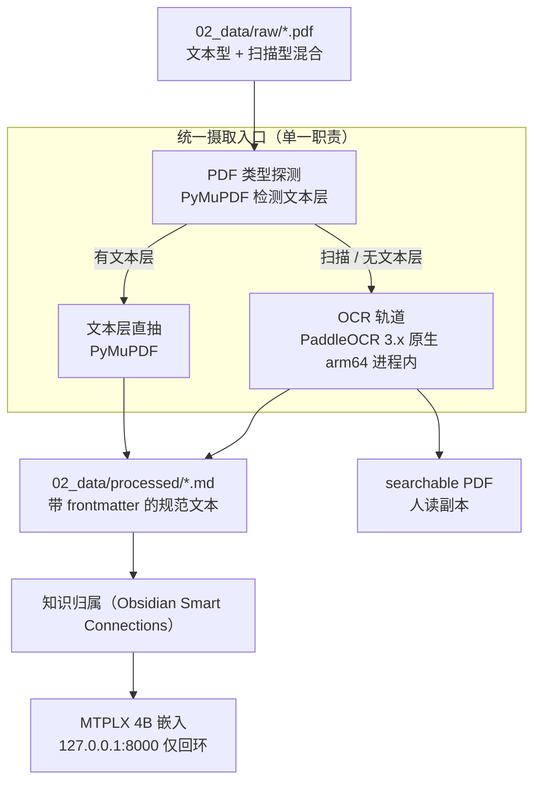

# PDF-RAG 摄取管线

> 设计依据：`PDF摄取方案与安全审计.md`、`个人AI实验室建设与部署方案.md`（数据分层）。
> 职责边界：**只负责把 PDF 变成规范 Markdown**，被哪个 RAG 前端消费另行决策，彻底解耦。

## 一、定位与架构

PDF 摄取链路 = `raw/*.pdf` → 统一摄取入口 `ingest.py` → `processed/*.md` +（可选）可搜索 PDF → 知识归属前端。



## 二、双轨策略

| 轨道 | 判定 | 实现 | 产物 |
| --- | --- | --- | --- |
| 文本直抽 | PyMuPDF 检测文本层（采样页平均字符 ≥ 50 且文本页占比 ≥ 0.5） | `doc[i].get_text("text")` | `processed/<name>.md` |
| OCR | 扫描 / 无文本层 | 原生 PaddleOCR 进程内调用 | `processed/<name>.md` + 可选可搜索 PDF |

## 三、关键技术选型

### 3.1 文本型：PyMuPDF（fitz）
- 纯 `pip` 安装进隔离 venv，**无 brew 依赖**（本机无 homebrew/macports/nix）。
- `pdfplumber` 作为异常兜底。

### 3.2 扫描型：PaddleOCR 3.x 原生 arm64（关键）
- **修正**：原方案靠 Docker 是为 x86 可复现；PaddlePaddle 官方提供 Apple Silicon 原生 wheel，官方 Docker 镜像**不支持** Apple Silicon。本机走 `pip install paddlepaddle paddleocr` 最干净。
- **arm64 专属坑（必避）**：PaddleOCR 3.x 默认开启 3 个预处理模型（文档方向 / 弯曲矫正 / 文本行方向），在 macOS ARM 会吃 **40GB+ 常驻内存**把系统卡死；**初始化时必须显式设为 `False`**（见 `ingest.py` `_build_ocr_engine`）。关闭后常驻内存降到 <1GB。
- 实测安装 `paddlepaddle 3.3.1` + `paddleocr 3.7.0`，默认 `PP-OCRv6_medium` 在 arm64 开箱即用。
- **形态**：进程内 Python API 调用（无 HTTP 服务、无对外端口）。

### 3.3 命名坑
PP-OCRv6 系列档位为 **medium / small / tiny**，**无 mobile**（mobile 属 v4/v5 系列）。直接写 `PP-OCRv6_mobile_det` 会报 `No engine bindings registered`。

## 四、参数调优实测（M5 Max）

每个配置在**独立子进程**运行以避免内存读数互相干扰，并以基线识别文本做相似度比对作为质量参照：

| 配置 | 秒/页 | 峰值内存 | 字符数 | 质量相似度 |
| --- | ---: | ---: | ---: | ---: |
| A 基线 v6_medium/200DPI/4线程 | 14.06 | 8913 MB | 2153 | 1.000 |
| B v6_small/200 | 4.41 | 3932 MB | 2037 | 0.940 |
| C v6_small/150 | 3.60 | 2108 MB | 1980 | 0.927 |
| **D v6_tiny/150** | **1.35** | **1757 MB** | 2046 | 0.922 |
| E v6_small/150/2线程 | 3.60 | 2108 MB | 1980 | 0.927 |
| F v6_small/200/det640 | 4.41 | 3923 MB | 2037 | 0.940 |

**结论**：
1. 模型档位是主导杠杆：`medium → tiny` 提速 **10.4×**、内存降至 **1/5**。
2. 渲染 DPI 是有效次级杠杆：200 → 150 内存再降 46%、耗时降 18%。
3. 线程数与 `text_det_limit_side_len` 在 paddlex 3.7 下**无效**（E/F 与对照一致），已移除无效开关。

**质量核验**：相似度 0.92~0.94 的差距主要来自全角/半角标点归一化与省略号丢失，**非实质性错字**；降档安全。

**档位化（已落 `ingest.py` 的 `OCR_PRESETS`）**：

| 档位 | 模型 | DPI | 秒/页 | 内存 | 414 页全书 | 适用 |
| --- | --- | ---: | ---: | ---: | ---: | --- |
| `fast` | PP-OCRv6_tiny | 150 | 1.35 | ~1.8 GB | 实测 9.5 分钟 | 清晰印刷体（批量书稿推荐） |
| `balanced`（默认） | PP-OCRv6_small | 150 | 3.60 | ~2.1 GB | 约 25 分钟 | 通用 |
| `quality` | PP-OCRv6_medium | 200 | 14.06 | ~8.9 GB | 约 97 分钟 | 小字号/低质量扫描件才启用 |

> 全书实测（414 页扫描书，`fast` 档）：570 秒完成，产出 335,220 字符、667KB 的 `*.md` + 48MB 可搜索 PDF；相比基线档约 97 分钟**提速 10.2×**。

## 五、用法

```bash
# 处理单个文件（自动判定轨道）
python ingest.py --file 02_data/raw/xxx.pdf

# 处理整个目录
python ingest.py --dir 02_data/raw

# 扫描件测试：只跑前 10 页，并额外产出可搜索 PDF
python ingest.py --file 02_data/raw/xxx.pdf --max-pages 10 --searchable

# 选择 OCR 质量档位
python ingest.py --file 02_data/raw/xxx.pdf --ocr-quality fast
```

## 六、安全审计（补充项）

- OCR 改为原生进程内调用，**无对外 HTTP 端口**，攻击面较容器方案显著缩小。
- **所有 OCR 走本地，禁止任何云端 OCR**；L3 高敏 PDF（合同/财务/健康）误经云端即违规。
- `raw/*.pdf` 与 `searchable/*.pdf` 为二进制大文件，进 `.gitignore`，不进 vault（避免同步膨胀 + 版权/敏感泄露）。
- 受版权材料（书籍/研报）OCR 需合规；L3 更要本地隔离，绝不外发。

## 七、数据生命周期与 Git 策略

| 产物 | 位置 | 是否入 Git / vault | 性质 |
| --- | --- | --- | --- |
| 原始 PDF | `02_data/raw/` | **否**（`.gitignore`） | 真相源，只读 |
| 规范文本 `*.md` | `02_data/processed/` | **是**（文本，进 vault 被检索） | 契约产物，可重建 |
| 可搜索 PDF | `02_data/processed/searchable/` | **否** | 人读副本，可重建 |
| 向量索引 | `04_storage_indices/` | 否（易失，可重建） | 派生缓存 |

> 索引易失化：文本原件（md）始终保留，embedding 模型或切分规则升级时直接清空旧库全量重建。
